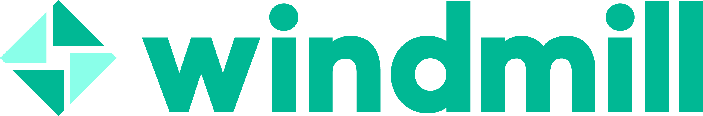

<p></p>

Windmill is an iPhone app for short looping videos. You record a few clips, join them, put text on top and post the video to a feed of the people you follow. It was first built in 2020 with Swift 5, CocoaPods and a Go server on MongoDB and S3; that version is on the [`master`](https://github.com/liamreardon/windmill/tree/master) branch.

This branch, `v2`, is a rebuild in SwiftUI and Swift 6 for iOS 18, with a new Go service. It is in progress: what works is below, and what comes next is in [ROADMAP.md](ROADMAP.md).

## What works now

**WindmillVideo** is a Swift package in `windmill-ios/Packages/WindmillVideo` that holds all the video code, so the screens stay thin.

- Recording: hold to record, up to 15 seconds in clips of at least half a second. The recorder's rules are a plain function, `recorderStep`, tested on a Mac with no camera. `Recorder` runs them on AVFoundation with the front and back cameras, the torch and zoom.
- Editing: `Edit` holds the clips in order, a trim of at least a second and the text overlays. `Composer.make` joins the clips into one composition and draws the text with a Core Image compositor.
- Export: `Exporter.export` writes a 1080x1920 H.264 MP4 at 30 fps, brings HDR clips from the iPhone camera down to SDR, refuses a file over 50 MB and makes a thumbnail.
- Playback: `LoopingPlayer` and `LoopingVideoView` loop a file or a composition with no gap at the restart.

60 tests run with `swift test` on macOS, and CI runs the package tests on iOS 26 and iOS 18 simulators.

**The app and the server** are skeletons for now. The app target is made with xcodegen and checks its config on launch, and the Go service builds and runs its tests. The screens and the API are the next part of the work.

## Run it

You need Xcode 26, xcodegen and Go 1.21 or newer. `make doctor` checks for them and installs nothing.

```
git clone -b v2 https://github.com/liamreardon/windmill.git
cd windmill
make doctor
make ios
```

`make ios` makes the Xcode project and opens it. The tests:

```
make test
cd windmill-ios/Packages/WindmillVideo && swift test
```

## License

MIT, see [LICENSE](LICENSE).
